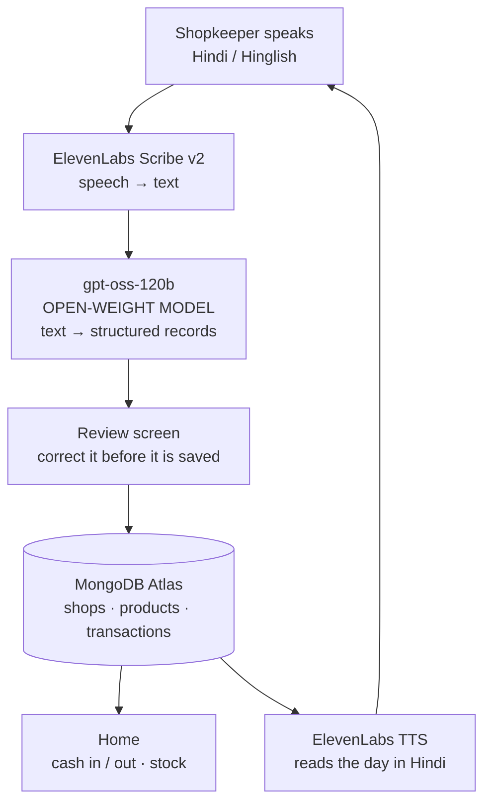

*This is a submission for the [Hacktoberfest Open-Source AI Challenge Week 2: Side Hustle](https://dev.to/challenges/hacktoberfest-week2-2026-10-12)*

## What I Built

My local kirana shop keeps its accounts in a paper khata. The owner writes in it twice a day, when the shop is quiet, from memory. Some days he doesn't.

He has a smartphone. He has tried two accounting apps. Both wanted him to tap through four screens to record one sale of sugar — slower than the sale itself — and both assumed he reads English comfortably. So the khata stays paper, and at the end of the month nobody really knows what the shop made.

**Auditly removes the typing.** He presses one button and says what happened, in Hindi or Hinglish, the way he'd say it to a person:

```
"paanch kilo cheeni bechi do sau rupaye kilo, aur bijli ka bill bhara baarah sau rupaye"
 (sold five kilos of sugar at two hundred a kilo, and paid the electricity bill, twelve hundred)
```

Two records appear on screen:

| | Item | Qty | Amount |
|---|---|---|---|
| **Bikri** (sale) | Cheeni | 5 kg | **₹1,000** |
| **Kharch** (expense) | Bijli ka bill | — | **₹1,200** |

Note the ₹1,000. He said "two hundred rupees a *kilo*" — a rate, not a total. Getting that wrong is the difference between a useful ledger and a worthless one, and it is the single thing I spent the most time on.

He checks the two rows, fixes anything wrong, saves. Stock moves. And then the app reads his day back to him, out loud, in Hindi:

> नमस्ते। आज की बिक्री 1400 रुपये। खर्च 1700 रुपये। आज 300 रुपये ज़्यादा खर्च हुए।

The whole loop is voice, in both directions. Someone who reads slowly can still run their books.

### Who would pay for this

The shopkeeper, directly. A kirana owner will not pay for "business intelligence". He will pay a small monthly fee to stop losing an hour a day and to stop guessing whether this month was better than last. The pitch is one sentence: *bolo, hisaab ho gaya* — speak, and it's done.

There's a second, larger buyer behind that: distributors and FMCG brands pay real money for retail demand data they currently have to infer. But that only works if the shopkeeper trusts the app enough to use it daily, which is why I spent my time on trust rather than dashboards.

**Being straight with you: I have not charged anyone yet, and I haven't put it in a real shop.** That's the next thing I do, and it's the part that would actually tell me if any of the above is true.

## Demo

🔗 **Try it: (https://auditly-rosy.vercel.app/)**

**Open it on a phone if you can.** It's built for one hand behind a counter, and the
microphone needs HTTPS — which the deployed version has.

Thirty seconds to see the whole thing:

1. Press the green mic and say *"paanch kilo cheeni bechi do sau rupaye kilo"* — in
   Hindi, Hinglish, or English. No signup, nothing to configure.
2. Watch the review screen. Two things to notice: the transcript comes back in
   Devanagari, and the amount is **₹1,000**, not ₹200 — it worked out the rate.
3. Change something, to see that you always get the last word. Then save.
4. Press the dark speaker button and it reads your day back in Hindi.
5. Open **Purane records** and press *Theek karein* on any row. Change the amount and
   save — the original stays, struck through, with the new one beside it.

Step 5 is the one I'd look at first if I were judging.

> It's a shared public demo, so you may well find somebody else's sugar in the ledger.
> That seemed more useful than hiding it behind a login.

## Code



## How I Built It



### The open-weight model is the brain

The part that actually makes Auditly work is **`gpt-oss-120b`**, an open-weight model whose weights are published for anyone to download and self-host. I serve it through Groq's OpenAI-compatible endpoint for speed, but nothing about my code is tied to Groq: the request is a standard `chat/completions` call, so pointing it at a local Ollama instance is a change to **one constant**.

Its whole job is turning a sentence into rows. The prompt is ~60 lines of plain instruction, and it does four things a generic parser can't:

- **Rate vs total.** `"do sau rupaye kilo"` × 5 kg → ₹1,000. `"hazaar rupaye ki"` → ₹1,000 flat.
- **Spoken Hindi numbers.** `dhai` → 2.5 · `do sau` → 200 · `baarah sau` → 1200 · `aadha` → 0.5
- **Either script, or both at once.** `पाँच किलो चीनी`, `paanch kilo cheeni`, and `5 किलो cheeni` all parse. Product names always come back romanised so the UI stays consistent.
- **Knowing when nothing happened.** `"namaste bhai kaise ho"` returns zero records instead of inventing a sale.

I don't trust it blindly. The model is asked for JSON at the API level, and then every field is re-validated in my own code — type, name, amount, quantity, unit. Small mistakes get repaired (a number where a string belonged, an unrecognised unit). Anything unusable returns an empty list and the shopkeeper types the row instead. A retry loop would cost him time; a text box costs him five seconds.

There are **8 automated checks** for exactly these cases, and they run for free.

### Voice in and out: ElevenLabs

**Scribe v2** does speech-to-text and **`eleven_multilingual_v2`** does the speaking. This is the one closed piece in the stack, and I'd rather say that plainly than dress it up. I'm entering the ElevenLabs category because the voice quality is genuinely why the round trip feels like talking to a person instead of operating a machine.

The spoken summary is composed in **Devanagari**, deliberately, even though the buttons are in Latin script. Given `आज की बिक्री`, the multilingual model produces real Hindi; given `aaj ki bikri` it reads English phonetics and sounds wrong.

Two things I built around the free tier, which gives 10,000 credits a month:

- **Spending is off by default.** Both voice features need an explicit `false` in the environment *and* a valid key before a single credit is used. Development runs on a saved transcript and the browser's own voice.
- **`/api/speak` takes no text.** It composes the sentence server-side from the database. An endpoint that voices whatever you POST to it is a free way for a stranger to drain your month.

A detail worth writing down for anyone else hitting it: on the free plan, ElevenLabs **refuses "library" voices over the API with `HTTP 402` but allows "premade" ones**. I burned an afternoon on that error message before a 7-character test call told me the real rule.

### Storage: MongoDB Atlas

Three collections — `shops`, `products`, `transactions` — on the free tier, via Mongoose.

Four decisions I'd defend in a code review:

1. **Money is integer paise.** ₹1,000 is stored as `100000`. Money never touches a float, so rounding can never quietly accumulate across a year of sales.
2. **Stock is calculated, not stored.** Current stock = opening + everything bought − everything sold. There's no counter to drift out of sync with reality.
3. **The catalogue builds itself.** Say "cheeni" and the product is created. Say `"  Cheeni "` next week and a lowercase key matches it to the same product instead of making a second one.
4. **Nothing is ever deleted or overwritten.** Correcting a record inserts a new row and marks the old one `corrected`, pointing at its replacement. Both stay visible in History, the old one struck through. The replacement keeps the *original* date, so fixing yesterday's sale doesn't move the money into today's takings. Day totals count the replacement only.

That last one is the feature I'm proudest of, and it isn't technically impressive — it's just a decision. A shopkeeper has spent his life with a paper book nobody can secretly edit. If my app can quietly change yesterday's numbers, it is worth less to him than the paper. **20 automated checks** exist purely to prove the original survives a correction.

### One more honest detail

The summary card says **"Aaj ka cash"** and never "profit", with a line underneath: *yeh profit nahi hai* — this is not profit. Cost of goods sold isn't tracked yet, so calling cash-in-minus-cash-out "profit" would mislead the one person relying on it. I'd rather ship a smaller true number than a bigger false one.

**Stack:** Next.js 16 (App Router, Cache Components) · TypeScript · Tailwind v4 · MongoDB Atlas · Mongoose · gpt-oss-120b on Groq · ElevenLabs Scribe v2 + multilingual v2 · 42 automated checks · **₹0/month to run**

## Why Does Open Innovation Matter?

Four reasons, specific to this build.

**1. The business only exists at zero marginal cost.** A kirana shop runs on thin margins. If every spoken sentence cost me a few paise through a closed API, I'd have to charge enough to cover a per-call fee on something a shopkeeper does fifty times a day — and at that price he goes back to paper. Open weights on a free tier, or on hardware I already own, mean the cost of one more record is effectively nothing. That isn't a nice-to-have; it is the entire reason the product can be cheap enough to adopt.

**2. His data can stay in his shop.** Right now the transcript goes to an API. But because the weights are *published*, the understanding step can run on a laptop in the back of the shop with no internet involved — the same model, the same prompt, a different base URL. I cannot offer that with a closed model at any price, because I can't download it. For someone whose turnover is his most sensitive number, "it never leaves this room" is a real feature, and open weights are the only way I can ever promise it.

**3. Hinglish is a long tail nobody else will fix for me.** `dhai`, `baarah sau`, `paav`, code-switching mid-sentence, and the regional vocabulary that changes between two districts. A general-purpose closed API handles this acceptably and will never handle it *well*, because my users are a rounding error in its training priorities. With open weights I can fine-tune on Hinglish shop-talk. Today I'm doing it with prompt engineering because that was what fit in a week; the path to doing it properly exists only because the model is open.

**4. No pricing lock-in on infrastructure I don't control.** My entire dependency on the model is a URL constant and a text prompt. If Groq's free tier changes tomorrow I move to another host, or to my own machine, and the prompt comes with me. Had I built the core on a proprietary model, a pricing page I don't control would sit between my users and their own accounts.

And the honest counterweight: **the voice layer is closed today.** ElevenLabs does the listening and the speaking, and it's good enough that I'd miss it. But the app already ships a fully-open fallback — the browser's built-in speech synthesis reads the summary when ElevenLabs isn't configured, free and offline. The open path works; the closed one just sounds better. If the economics ever force the choice, the app keeps running.

## Prize Categories

- **Best Use of ElevenLabs** — speech-to-text for Hindi/Hinglish input, and text-to-speech reading the day's figures back in Devanagari Hindi. Both directions of the core loop.
- **Best Use of MongoDB Atlas** — three collections modelling an append-only ledger: integer paise, derived stock, and corrections that supersede rather than overwrite.

---

*Built between 13 and 18 October 2026. Free tiers only, start to finish.*
